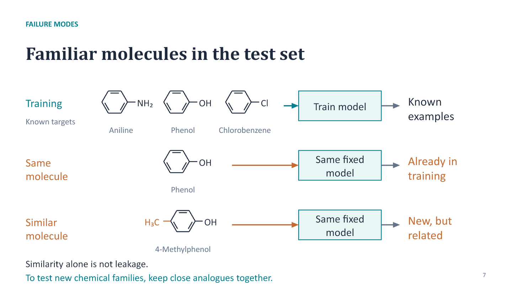

# Part 3 - Evaluation of trained models (3 h CM + 1 h TD)

Contents:
- `notes/` - lecture notes (Markdown).
- `slides/` - deck (.pptx) and its Markdown equivalent (.md).
- `slides/resources/` - rendered PDF and SVG figures.
- `notebooks/` - TD notebooks, student and instructor/solution versions.

## Additional lecture slides: failure modes

- [Editable PowerPoint slides: visual revision](slides/Part3_Failure_modes_visual.pptx).
- [Slide outline and teaching notes](slides/Part3_Failure_modes_visual.md).

Eleven additional slides explain underfitting, overfitting, bias in the data,
out-of-distribution predictions and information leakage through fresh
analytical-chemistry examples.
Simulated calibration standards show the effects of model flexibility and
extrapolation. A hypothetical contaminant-screening example compares drinking
water with river water to show how an overall accuracy can hide poor performance
for one matrix. Three visual leakage slides use molecular structures,
schematic repeat scans and preparation workflows. The first compares reuse
of a training molecule with prediction of a close analogue: phenol and
4-methylphenol share a core structure, with the added methyl group highlighted.
It distinguishes direct overlap from testing familiar chemistry. Similarity
alone is not leakage, but a claim about new chemical families needs a split
that keeps close analogues together. The next diagrams show repeat scans of
one phenol specimen crossing the split and test data influencing learned
preprocessing. They distinguish legitimate validation-based
model choice from using the final test to make choices. A comparison slide
connects each failure to a useful next check, and five short cases invite
interpretation. Speaker notes include suggested answers, sources and the
distinction between data bias and statistical bias.
The charts, tables, molecular bonds, atom labels and arrows remain editable.
RDKit validates the molecular graphs and supplies their coordinates. The
teaching notes include the compound identities, SMILES and source details.

Suggested placement: replace slides 4–5 of the main deck with this sequence,
after the Failure modes divider, then continue with the existing generalisation
slide. The original PowerPoint, Markdown outline and PDF remain separate.

## Current practical: strawberry model evaluation

- [Student Colab notebook](notebooks/TD2_strawberry_student.ipynb) 
- [Instructor version with discussion notes](notebooks/TD2_strawberry_solution.ipynb) 

All code is supplied in short cells, each preceded by a plain-language explanation.
Seven written questions cover overfitting, fair pipeline comparison, a small
CNN, model choice, mistakes and a tree-depth curve. No coding or parameter
changes are required.
The opening is a quick recap of Foundations: four setup cells prepare the same
data and show one feature-table reminder. Students then move directly to the
new training–validation–test split. The detailed source-table previews,
spectrum plots and introductory feature question remain in Foundations.

Using the same eight spectral summaries as Foundations, students fit a small
tree, a deep tree and a random forest. A worked three-tree example explains
how varied sorting routes combine class-support estimates. Students then fit
a small 1D CNN to the full 235-position spectra, with scaling learned only
from training spectra. One local-window illustration explains its five-position
filters, followed by a short layer-by-layer description. The network has 505
trainable parameters and fixed settings: eight filters, pooling, a single
output, 30 epochs and batches of 32.

The comparison table records each input representation alongside training and
validation accuracy. Students choose using validation results, then inspect
the chosen model's test confusion matrix. This compares complete pipelines:
CNN/forest differences cannot be attributed to architecture alone.

After this choice and check, a line plot shows training and test accuracy for
tree depths 1–30 on the same samples. It illustrates overfitting. The notebook
explains that choosing a new depth from this test curve would require a new
independent final test. Cross-validation, SVMs and statistical model comparisons
remain outside this introductory version. The notebook has four figures.

The 981 cleaned observations are divided into 588 training, 196 validation and
197 test observations. Test membership matches Foundations; its reuse is a
classroom comparison rather than new independent evidence. Each notebook runs
on its own in a CPU Colab runtime and downloads the version-pinned data file.
The notebook explains why the smaller training group can change the small
tree's results, defines overfitting before asking students to interpret it,
and introduces the outlier-screening question taken up in Applications.

See [data provenance and licence](../datasets/strawberry/README.md). The earlier
`TD2_evaluation_student.ipynb` and `TD2_evaluation_solution.ipynb` use the
scikit-learn diagnostic dataset and remain available as legacy exercises.

## Parallel practical: Tox21 model evaluation

- [Student notebook](notebooks/TD2_tox21_student.ipynb) 
- [Instructor notebook with suggested answers](notebooks/TD2_tox21_solution.ipynb) 

The same simple format, using DeepChem's public Tox21 data: all code supplied
in cells of at most ten lines and six written questions. Four setup cells
recap the data preparation from Foundations, with one descriptor-table reminder,
before students begin the training–validation–test split and model comparison.
Eight calculated molecular descriptors predict the SR-MMP assay result.
Students compare a small tree, a deep tree and a random forest, then inspect
the chosen model's missed Active results and false alarms. The notebook
explains the unequal class sizes and the fixed class-balancing setting.
Its random-forest explanation uses the same small support-averaging example
and asks why varied trees help more than identical copies.
After the chosen model's test check, a third figure plots training and test
accuracy for depths 1–30. Each tree uses the same 3,482 training compounds,
eight descriptors, balanced class importance and random seed. This is an
overfitting illustration: choosing a depth from the test curve would require
a new independent final test. The instructor copy includes the saved curve
values and a matching interpretation answer.

The Tox21 series shares one cleaned subset and test group. Evaluation divides
the Foundations training group into 3,482 training and 1,161 validation records;
the same 1,161 test records remain excluded from model choice. The final
question introduces the descriptor-outlier task in Applications. See
[data preparation and provenance](../datasets/tox21/README.md).
